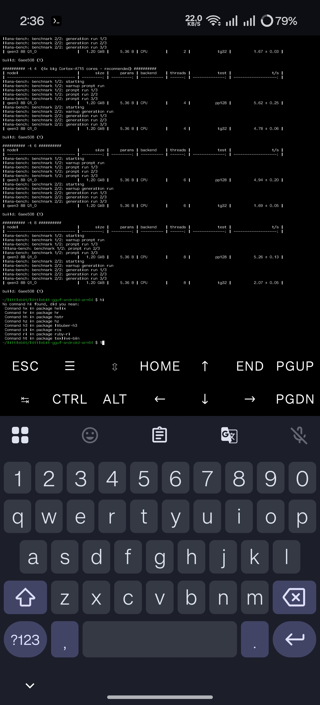
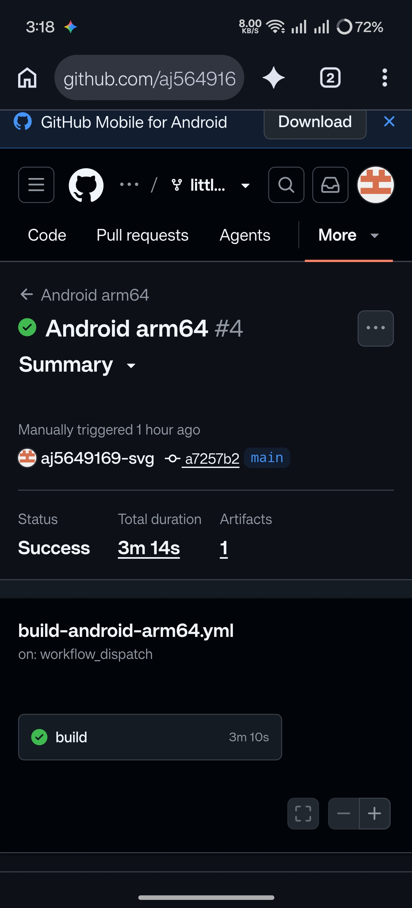

# littlebit-gguf

Run **sub-1-bit LittleBit and LittleBit-2 language models in llama.cpp**, using the 1-bit `Q1_0` tensor type llama.cpp already ships instead of writing new kernels.

> **This is a research project.** It is independent and experimental, and it is not affiliated with or endorsed by Samsung or the llama.cpp project. Expect breaking changes and rough edges.

## The idea

LittleBit (Samsung Research, NeurIPS 2025) and LittleBit-2 (ICML 2026) compress every linear layer of a transformer into two small sign matrices and three scale vectors, reaching 0.1 to 1 bit per weight. A layer computes:

```
y = h ⊙ U±( l ⊙ V±( g ⊙ x ) )
```

llama.cpp's `Q1_0` type stores weights in blocks of 128 bits with one fp16 scale `d` per block, and each bit means `+d` or `−d`. Because that scale belongs to a block within a single row, LittleBit's row scales fold straight into it:

- `V' = diag(l) · V±` : every block in row `k` gets `d = l_k`
- `U' = diag(h) · U±` : every block in row `i` gets `d = h_i`

So a LittleBit layer becomes one element-wise multiply and two ordinary `Q1_0` matrix multiplies:

```
y = U' · ( V' · ( g ⊙ x ) )          (and the same again for the residual path)
```

The patched graph uses ggml's existing `Q1_0` kernel and element-wise multiply.

## What it costs

`Q1_0` needs each row length to be a multiple of 128, so the rank is padded up to the next multiple of 128 (padded rows get `d = 0` and add nothing), and each block carries 16 bits of scale. Estimated bits per weight for the compressed layers:

| Model | Trained at | In GGUF |
|---|---|---|
| Llama-2-7B | 1.0 | ~1.15 |
| Llama-2-7B | 0.55 | ~0.69 |
| Llama-2-7B | 0.1 | ~0.12 |
| Qwen2.5-0.5B | 0.55 | ~0.80 |
| Qwen2.5-0.5B | 0.1 | ~0.47 |

Large models lose little. Small models at very low bit rates lose a lot to padding, because their ranks are tiny. Training with ranks that are multiples of 128 avoids it, and the converter warns when padding is heavy. (Estimates from the shape arithmetic; the converter prints the real figure for each file.)

The other half of the story is the layers LittleBit leaves alone. The reference keeps token embeddings and the output layer in 16 bits, and in small models they are most of the file: about 272 MB for Qwen2.5-0.5B next to about 4 MB of LittleBit layers at 0.1 bits per weight. The converter can store them as `Q8_0`, `Q6_K` or `Q4_K` instead.

## Status

| Component | Status |
| --- | --- |
| Design and format notes | Done. See [design](docs/DESIGN.md) and [format](docs/FORMAT.md). |
| Converter and embedding fallbacks | Done for F16, Q8_0, Q4_K and Q6_K requests, including tied embeddings. |
| llama.cpp CPU patch | Done for Llama, Qwen2 and Qwen3 with projection inputs divisible by 128. |
| Fast tests, published checkpoint checks and CPU benchmarks | Done. Published checks cover Qwen2.5 and Qwen3 at both bit rates. |
| Qwen3-0.6B 1.0 bpw under the original float limits | Failing under the original limits. The published test uses limits based on measured cache and activation rounding for this checkpoint. |
| Architecture coverage and upstream integration | Partial. More architectures and backends remain outside the CPU milestone. The local patch is required. |

Until the changes are upstream, LittleBit GGUF files need the patched build from this repo. Stock llama.cpp, Ollama and LM Studio will not load them yet.

## Build on Linux or WSL

The llama.cpp submodule is pinned to `6aee50801d091f78b3baacd505f5e95d8e8f6838`. The build script initializes the submodule, applies the patches, and builds the CPU tools. It can be rerun on the same checkout. Use a C++ compiler, CMake, Ninja, and Python 3.12.

```sh
python3.12 -m venv .venv
. .venv/bin/activate
python -m pip install 'torch>=2.6' --index-url https://download.pytorch.org/whl/cpu
python -m pip install -r requirements.txt pytest ruff
bash scripts/build.sh
python -m pytest
```

Set `LITTLEBIT_BUILD_DIR` to an absolute path to put build output on another drive. Set `LITTLEBIT_JOBS` to change the build's two-job default. `LITTLEBIT_NATIVE=OFF` disables CPU-native tuning.

## Convert and run

```sh
python convert_littlebit_to_gguf.py checkpoints/littlebit --outfile model.gguf \
    --embd-type q8_0 --validate 5
build/bin/llama-cli -m model.gguf -ngl 0 -t 4 -c 512 --single-turn -p 'Once upon a time' -n 32
```

The converter reads `littlebit_config.json` or the fields in `config.json`. Older checkpoints can supply `--eff-bit`, `--residual` or `--no-residual`, and `--use-itq` when needed. `--embd-type` and `--output-type` accept `f16`, `q8_0`, `q6_k`, and `q4_k`. The output defaults to the embedding type. Tied embeddings remain shared when the effective embedding and output types match. Aligned K types require the compiled `libggml-base.so`. When the row width is incompatible, the converter prints a notice and uses the same fallback types as the pinned `llama-quantize`: Q4_K becomes Q5_0, and Q6_K becomes Q8_0. If the width also fails the smaller block alignment, the converter uses F16. Qwen2.5-0.5B uses the fallback at width 896. SmolLM2-135M is out of scope because its 576-wide projections fail the 128-column input alignment.

The synthetic generator applies Dual-SVID initialization to a local Hugging Face checkpoint or model ID. It supports `--residual` and `--no-residual`. Synthetic checkpoints are for arithmetic and runtime checks. Their language-model quality reflects initialization without training.

The slow test compares four synthetic checkpoints with a plain PyTorch reference and a reference that rounds activations before both Q1_0 matmuls. For Qwen3-0.6B at 1.0 bpw, changing only the cache precision moved logits by up to 5.54. The Q8-aware reference and F32-cache runtime agreed on 77.86% of token positions. The test uses a separate tolerance for this checkpoint and checks the Q8-aware result separately.

```sh
python tools/make_synthetic.py Qwen/Qwen3-0.6B checkpoints/qwen3-0.1 --eff-bit 0.1
python convert_littlebit_to_gguf.py checkpoints/qwen3-0.1 --outfile checkpoints/qwen3-0.1-f16.gguf
LITTLEBIT_TEST_DATA=checkpoints python -m pytest -m slow -s -k '0.1 and qwen3'
```

## Measured file sizes

These are initialized synthetic checkpoints with residuals enabled and tied embeddings. File sizes include metadata and tokenizer data and use decimal MB. Projection bits per weight exclude embeddings and the output head.

| Model | Target bpw | Requested embedding | Stored embedding | File (MB) | Projection bpw |
| --- | --- | --- | --- | --- | --- |
| Qwen2.5-0.5B | 0.1 | F16 | F16 | 300.31 | 0.4865 |
| Qwen2.5-0.5B | 0.1 | Q8_0 | Q8_0 | 172.69 | 0.4865 |
| Qwen2.5-0.5B | 0.1 | Q4_K | Q5_0 | 121.64 | 0.4865 |
| Qwen2.5-0.5B | 0.1 | Q6_K | Q8_0 | 172.69 | 0.4865 |
| Qwen2.5-0.5B | 1.0 | F16 | F16 | 333.27 | 1.2234 |
| Qwen2.5-0.5B | 1.0 | Q8_0 | Q8_0 | 205.64 | 1.2234 |
| Qwen2.5-0.5B | 1.0 | Q4_K | Q5_0 | 154.59 | 1.2234 |
| Qwen2.5-0.5B | 1.0 | Q6_K | Q8_0 | 205.64 | 1.2234 |
| Qwen3-0.6B | 0.1 | F16 | F16 | 342.44 | 0.4542 |
| Qwen3-0.6B | 0.1 | Q8_0 | Q8_0 | 196.58 | 0.4542 |
| Qwen3-0.6B | 0.1 | Q4_K | Q4_K | 118.79 | 0.4542 |
| Qwen3-0.6B | 1.0 | F16 | F16 | 383.72 | 1.2042 |
| Qwen3-0.6B | 1.0 | Q8_0 | Q8_0 | 237.87 | 1.2042 |
| Qwen3-0.6B | 1.0 | Q4_K | Q4_K | 160.07 | 1.2042 |

The Qwen2.5-0.5B run at 0.1 measured 0.4865 bits per compressed weight, compared with the shape estimate of about 0.47 above. Rank padding and the F32 input scales count toward the measured figure.

## CPU throughput

Measured on an Intel Core i7-8550U in Ubuntu WSL2 with the pinned llama.cpp commit above. The Release build used `GGML_NATIVE=ON` with AVX2, FMA, F16C and BMI2, and OpenMP was enabled. GPU backends and BLAS were disabled. All rows ran sequentially in one session with four CPU threads. Timings are the mean and standard deviation of five repetitions. Batch size was 2048, micro-batch size was 512 and flash attention used automatic selection.

```sh
build/bin/llama-bench -m model.gguf -ngl 0 -t 4 -p 128 -n 32 -r 5 -o json
```

| Model | Weights | File (MB) | Prompt 128 (tok/s) | Generation 32 (tok/s) |
| --- | --- | --- | --- | --- |
| Qwen2.5-0.5B | LittleBit 0.1, F16 | 300.31 | 199.30 ± 23.38 | 29.93 ± 4.68 |
| Qwen2.5-0.5B | LittleBit 1.0, F16 | 333.27 | 110.14 ± 3.45 | 26.71 ± 2.49 |
| Qwen2.5-0.5B | Dense Q1_0 | 75.70 | 138.16 ± 12.68 | 65.67 ± 7.05 |
| Qwen2.5-0.5B | Dense Q4_0 | 284.09 | 231.68 ± 9.07 | 47.53 ± 1.02 |
| Qwen2.5-0.5B | Dense Q8_0 | 531.07 | 157.81 ± 18.79 | 19.24 ± 2.53 |
| Qwen2.5-0.5B | LittleBit 0.1, Q4_K → Q5_0 | 121.64 | 208.50 ± 9.51 | 57.36 ± 1.21 |
| Qwen2.5-0.5B | LittleBit 0.1, Q6_K → Q8_0 | 172.69 | 78.87 ± 15.66 | 45.49 ± 3.53 |
| Qwen2.5-0.5B | LittleBit 1.0, Q4_K → Q5_0 | 154.59 | 115.89 ± 4.86 | 42.19 ± 0.71 |
| Qwen2.5-0.5B | LittleBit 1.0, Q6_K → Q8_0 | 205.64 | 114.92 ± 6.52 | 38.45 ± 0.96 |
| Qwen3-0.6B | LittleBit 0.1, F16 | 342.44 | 188.86 ± 4.55 | 29.62 ± 5.69 |
| Qwen3-0.6B | LittleBit 0.1, Q4_K | 118.79 | 181.92 ± 5.46 | 55.46 ± 8.01 |
| Qwen3-0.6B | LittleBit 1.0, F16 | 383.72 | 64.27 ± 7.45 | 20.48 ± 1.04 |
| Qwen3-0.6B | Dense Q1_0 | 111.90 | 113.45 ± 12.12 | 46.66 ± 4.48 |
| Qwen3-0.6B | Dense Q4_0 | 428.97 | 172.80 ± 26.63 | 35.92 ± 4.72 |
| Qwen3-0.6B | Dense Q8_0 | 804.75 | 117.88 ± 13.26 | 19.10 ± 3.47 |

14 of the 30 timings had a standard deviation above 10% of the mean after five repetitions. The table gives the deviation for each comparison.

## Trained Qwen3-8B checkpoint

These measurements use a trained LittleBit-2 checkpoint with residual paths and untied embeddings and output weights. The checkpoint is CC BY-NC 4.0. The checkpoint and converted GGUFs are kept local. [Checkpoint revision `6b2c47a`](https://huggingface.co/LittleBitLLM/littlebit-qwen3-8b-0.55bpw/tree/6b2c47aa9707e624e2e737d16d64a66be8090ae9)

The tests ran on an Intel Core i7-8550U with four threads in Ubuntu WSL2 using the pinned CPU build. Perplexity uses 2,048-token windows of the WikiText-2 raw test split. Speed is the mean of five `llama-bench` repetitions at `-p 128 -n 32`.

| Embedding / output | File (GB) | PPL after 4 windows | PPL after 12 windows | Prompt 128 (tok/s) | Generation 32 (tok/s) |
| --- | ---: | ---: | ---: | ---: | ---: |
| Q4_K / Q6_K | 1.457 | 26.3547 | 20.9236 | 8.47 | 5.11 |
| F16 / F16 | 3.086 | 26.2586 | 20.8386 | 5.04 | 4.80 |

The compressed projections use 0.6787 bits per dense projection weight, including both paths and the F32 input multipliers. Rank padding accounts for 56.7 MB of projection data. Conversion with `--validate 3` flushed 56 nonzero scales to zero and preserved FP16 subnormals.

## Android (ARM64) Build, Conversion & Benchmark

This workflow builds the Android runtime in GitHub Actions, converts the model in Google Colab, and runs the resulting GGUF on a non-rooted ARM64 Android phone through Termux. No Android NDK, C++ compiler, or large build toolchain is required on the phone or on your personal computer: the cross-compilation and model conversion happen in cloud environments.

The steps below describe the checked-in [Android arm64 workflow](.github/workflows/build-android-arm64.yml), [Android build script](scripts/build-android.sh), and [Colab conversion notebook](notebooks/convert_littlebit_colab.ipynb).

### 1. Cloud cross-compilation with GitHub Actions

The **Android arm64** workflow can be started manually with `workflow_dispatch` or by pushing a `v*` tag. It checks out the repository and its llama.cpp submodule, then runs `scripts/build-android.sh` on a GitHub-hosted Ubuntu runner.

The build script:

- Applies the repository's llama.cpp patches (without applying a patch twice).
- Uses the Android NDK CMake toolchain to target `arm64-v8a` with Android API level 28.
- Builds Release shared libraries and the `llama-completion` and `llama-bench` executables.
- Sets `-DGGML_CPU_KLEIDIAI=ON` and `-DGGML_NATIVE=OFF`. KleidiAI support is enabled without compiling for the build runner's own CPU, allowing the Android binary to use runtime CPU-feature dispatch rather than requiring a device-specific build. The tested phone reports features including `asimddp` and `i8mm`.
- Disables the server and app targets with `-DLLAMA_BUILD_SERVER=OFF -DLLAMA_BUILD_APP=OFF`, and also disables tests.
- Collects the required shared libraries in the package's `lib/` directory. It checks ELF architecture and includes Android NDK `libc++_shared.so` when a binary has that runtime dependency.

The workflow validates the two executables and packaged shared libraries before uploading the `littlebit-gguf-android-arm64` artifact. The downloaded GitHub Actions artifact is a ZIP containing `littlebit-gguf-android-arm64.tar.gz`.

To build it:

1. Open [Actions → Android arm64](https://github.com/aj5649169-svg/littlebit-gguf/actions/workflows/build-android-arm64.yml).
2. Select **Run workflow**, keep the default branch selected, and start the workflow.
3. Wait for the run to finish successfully, open that run, and download the `littlebit-gguf-android-arm64` artifact ZIP.

The archive contains this layout:

```text
littlebit-gguf-android-arm64/
├── bin/
│   ├── llama-completion
│   └── llama-bench
├── lib/
│   └── *.so
├── run-android.sh
└── bench-android.sh
```

`run-android.sh` sets `LD_LIBRARY_PATH=./lib` (relative to the package directory) and launches `bin/llama-completion`. It defaults to `-t 4` when no thread option is supplied. Pass `-t 2` or `--threads 2` explicitly to override that default.

`bench-android.sh` prints the device SoC, Android release and SDK, and the CPU `Features` line from `/proc/cpuinfo`. It then runs `llama-bench` with CPU-only inference (`-ngl 0`) at prompt length 128 and generation length 32, repeating each measurement three times, for thread counts 2, 4, 6, and 8.

### 2. Convert the model in Google Colab

Open [`notebooks/convert_littlebit_colab.ipynb` in Google Colab](https://colab.research.google.com/github/aj5649169-svg/littlebit-gguf/blob/main/notebooks/convert_littlebit_colab.ipynb) and run the cells from top to bottom.

The notebook downloads `LittleBitLLM/littlebit-qwen3-8b-0.55bpw`, builds the CPU conversion/quantization tools in the Colab runtime, and writes:

```text
/content/littlebit-qwen3-8b-q4_k.gguf
```

The conversion uses `--embd-type q4_k --output-type q4_k` and `--validate 2`. The final notebook cells print the produced file's actual size and optionally mount Google Drive and copy it to:

```text
MyDrive/littlebit-qwen3-8b-q4_k.gguf
```

The notebook's introductory note estimates an output around 1.5 GB; the exact file size is printed by the notebook and can vary with checkpoint details. Keep this separate from the approximately **1.20 GiB loaded footprint** observed in the Android benchmark below. The checkpoint is distributed under **CC BY-NC 4.0**; respect its non-commercial restriction and the checkpoint's license terms when using or sharing the model.

> **Notebook source note:** The checked-in notebook currently clones `https://github.com/GeniusDevam/littlebit-gguf.git` when preparing its Colab runtime. This is the upstream repository URL encoded in the notebook; the Android Actions workflow described above runs from this fork.

### 3. Set up Termux on a non-rooted Android phone

Install **Termux from F-Droid**, not the Google Play build. This procedure does not require root access or changes to the Android system partition. The required files are the downloaded Actions artifact ZIP and the converted GGUF model, both placed in the phone's `Download` folder.

For clarity, the artifact ZIP should be named `littlebit-gguf-android-arm64.zip`. In Termux, grant shared-storage access and unpack the two archive layers:

```bash
termux-setup-storage
mkdir -p ~/littlebit && cd ~/littlebit
unzip ~/storage/downloads/littlebit-gguf-android-arm64.zip
tar -xzf littlebit-gguf-android-arm64.tar.gz
cd littlebit-gguf-android-arm64
```

After extraction, the model remains in Android's shared Downloads directory and the executables and libraries are in the current package directory. No compiler, NDK, or root shell is needed on the phone.

### 4. Run the benchmark sweep

In Termux, run the packaged sweep script:

```bash
LD_PRELOAD= sh bench-android.sh ~/storage/downloads/littlebit-qwen3-8b-q4_k.gguf --progress
```

The empty `LD_PRELOAD=` assignment is intentional in Termux: it avoids inherited preload settings that can cause conflicts with the Android NDK runtime libraries. The script passes `--progress` through to `llama-bench` and performs the four thread-count runs.

The underlying benchmark configuration is:

```bash
llama-bench -ngl 0 -p 128 -n 32 -r 3
```

The sweep also supplies the model path and varies `-t` across `2`, `4`, `6`, and `8`.

To run an interactive completion separately, the wrapper can be used directly; for example:

```bash
LD_PRELOAD= ./run-android.sh -m ~/storage/downloads/littlebit-qwen3-8b-q4_k.gguf -ngl 0 -t 4 -no-cnv --repeat-penalty 1.18 --dry-multiplier 0.8 -p "Once upon a time" -n 128
```

The wrapper automatically adds `-t 4` only when neither `-t` nor `--threads` was supplied.

### Verified Android benchmark: Realme P3 Ultra

The following are measured results from a **Realme P3 Ultra** running non-rooted Termux on Android 16. They are device-specific measurements, not guaranteed throughput for every ARM64 phone.

| Item | Measured configuration |
| --- | --- |
| Device | Realme P3 Ultra |
| SoC | MediaTek Dimensity 8350 Ultra (MT6897) |
| CPU topology | 4× Cortex-A715 performance cores + 4× Cortex-A510 efficiency cores |
| OS | Android 16 (SDK 36) |
| Environment | Non-rooted Termux |
| Detected CPU features | `asimddp`, `i8mm`, `sve`, `sve2`, `svei8mm`, `bf16` |
| Model | `LittleBitLLM/littlebit-qwen3-8b-0.55bpw` |
| Model format | Qwen3 8B, Q1_0 projection tensors, Q4_K embeddings/output via `--embd-type q4_k` |
| Loaded footprint | Approximately 1.20 GiB |
| Benchmark | `llama-bench -ngl 0 -p 128 -n 32 -r 3` |

#### Results by thread count

| Threads | Prompt processing (pp128) | Generation (tg32) | Notes |
| --- | ---: | ---: | --- |
| `-t 2` | 1.86 ± 0.03 t/s | 1.67 ± 0.03 t/s | Half of the big cores |
| `-t 4` | **5.62 ± 0.25 t/s** | **4.78 ± 0.06 t/s** | **Best overall; matches the 4× Cortex-A715 performance-core count** |
| `-t 6` | 4.94 ± 0.20 t/s | 1.69 ± 0.05 t/s | Adds work on the Cortex-A510 efficiency cores |
| `-t 8` | 5.26 ± 0.13 t/s | 2.07 ± 0.05 t/s | Efficiency-core contention/bottleneck |

**Termux benchmark output**



**Successful GitHub Actions Android ARM64 build**



### Engineering findings

- **Four threads are the best generation setting on this device.** The `-t 4` run reaches 4.78 t/s. Compared with `-t 6` and `-t 8`, that is approximately 2.8× and 2.3× faster generation, respectively. Four worker threads align with the four Cortex-A715 performance cores; adding threads brings the slower Cortex-A510 cores into the workload and reduces generation throughput.
- **KleidiAI accelerates supported tensor operations, not every tensor type.** Runtime logs report `KLEIDIAI = 1` for the supported Q4_K embedding/output operations. The Q1_0 projection tensors report that no KleidiAI kernel is available for `q1_0`; those operations fall back to the regular ARM NEON path. This is an expected fallback, not a build failure.
- **The checkpoint is an early research checkpoint, not a general-purpose chat model.** `littlebit-qwen3-8b-0.55bpw` is an early 0.5-epoch checkpoint compressed to 0.55 bits per weight. It demonstrates a sub-1-bit model footprint and mobile CPU inference, but its current quality is not suitable for general reasoning or chat. For raw completion, `-no-cnv` with `--repeat-penalty 1.18 --dry-multiplier 0.8` helps prevent repetitive token loops; it does not turn the research checkpoint into a fully trained assistant model.

---

## Related work

- LittleBit: [arXiv:2506.13771](https://arxiv.org/abs/2506.13771). LittleBit-2: [arXiv:2603.00042](https://arxiv.org/abs/2603.00042).
- Official training code: [SamsungLabs/LittleBit](https://github.com/SamsungLabs/LittleBit) (CC BY-NC 4.0). No code from it is used or redistributed here.
- [llama.cpp](https://github.com/ggml-org/llama.cpp) (MIT), whose `Q1_0` type was added for PrismML's 1-bit Bonsai models.
- Sister project: [littlebit.cpp](https://github.com/GeniusDevam/littlebit.cpp), dedicated CPU kernels for LittleBit layers.
- [luben93/littlebit-llamacpp](https://github.com/luben93/littlebit-llamacpp) (MIT) is a parallel implementation of the same Q1_0 approach.

## License

MIT, see [LICENSE](LICENSE). llama.cpp is MIT licensed. Model weights keep their own licenses.

## Citation

Please cite the original papers:

```bibtex
@inproceedings{lee2025littlebit,
  title     = {LittleBit: Ultra Low-Bit Quantization via Latent Factorization},
  author    = {Lee, Banseok and Kim, Dongkyu and You, Youngcheon and Kim, Youngmin},
  booktitle = {Advances in Neural Information Processing Systems},
  year      = {2025}
}

@inproceedings{lee2026littlebit2,
  title     = {LittleBit-2: Maximizing the Spectral Energy Gain in Sub-1-Bit LLMs via Latent Geometry Alignment},
  author    = {Lee, Banseok and Kim, Youngmin},
  booktitle = {International Conference on Machine Learning},
  year      = {2026}
}
```
